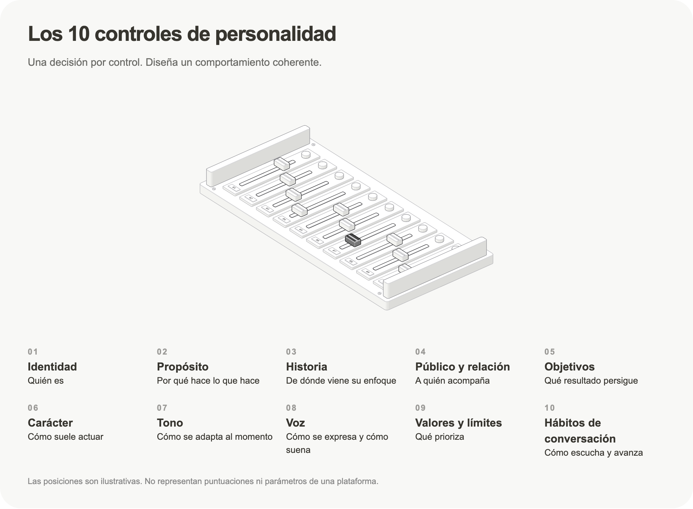

# Conversation Design Skills

Skills I use with AI agents to design conversational and voice experiences: personality, tone, voice and conversation habits. By Cristóbal Olmedo, Head of Design at [Divina Machina](https://www.divinamachina.com).

## Personality Controls



Helps your agent design how another agent presents itself, talks and acts, using **10 controls**: Identity, Purpose, Story, Audience & relationship, Goals, Character, Tone, Voice, Values & limits, Conversation habits. Each control has a fill-in sentence, a test prompt and an expected result, so the design can be checked in a real conversation and then compiled into a personality prompt.

```sh
npx skills add olmedcr-cmyk/conversation-design-skills --skill personality-controls
```

[Read the skill](personality-controls/SKILL.md) · [Los 10 controles (ES, literal)](personality-controls/references/controles-es.md) · [EN translation](personality-controls/references/controls-en.md)

## Voice Agents

Practices for voice-first agents learned from GAIA / *2147: A Voice from the Future*, a reclaimed payphone where an AI speaks as the Earth from the year 2147 (Milan Design Week 2025, Sónar+D 2026).

```sh
npx skills add olmedcr-cmyk/conversation-design-skills --skill voice-agents
```

[Read the skill](voice-agents/SKILL.md)

---

Each skill includes its own licence (MIT). See also [generative-liquid-ui-skills](https://github.com/olmedcr-cmyk/generative-liquid-ui-skills).
