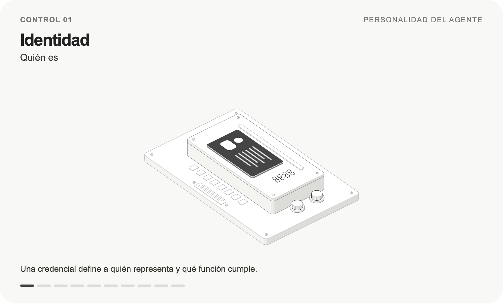
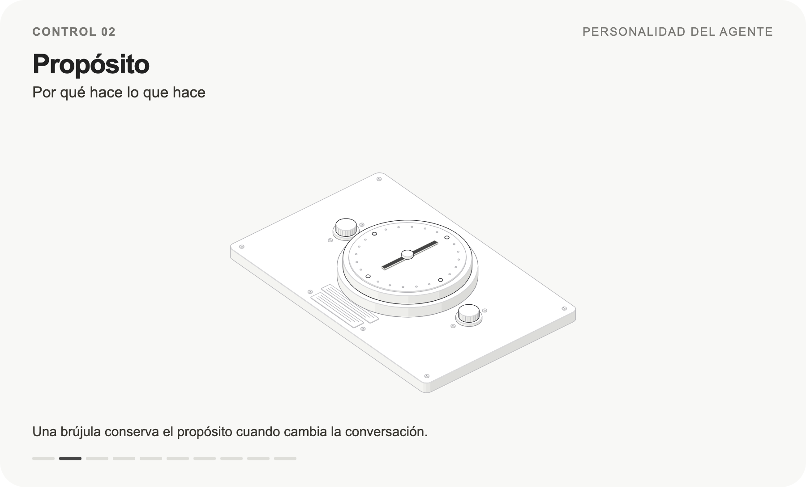
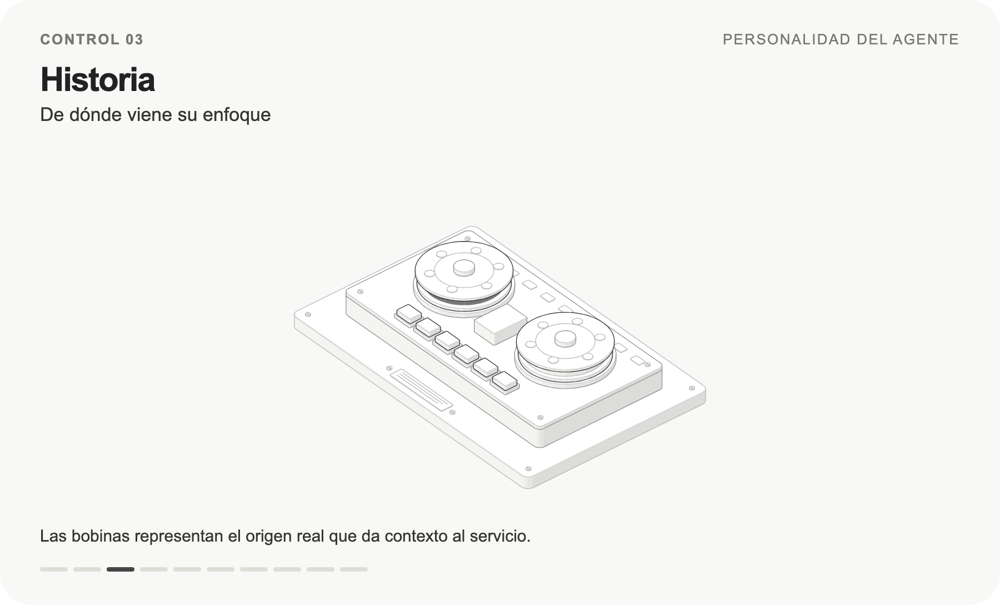
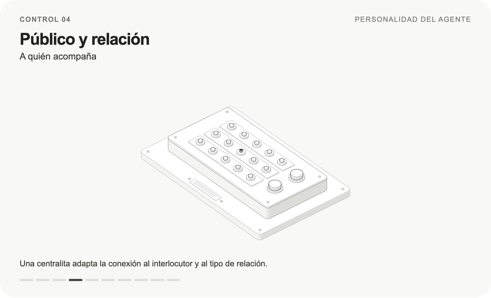
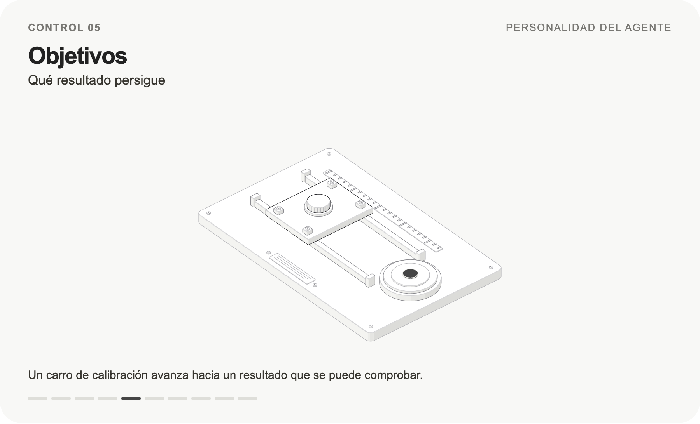
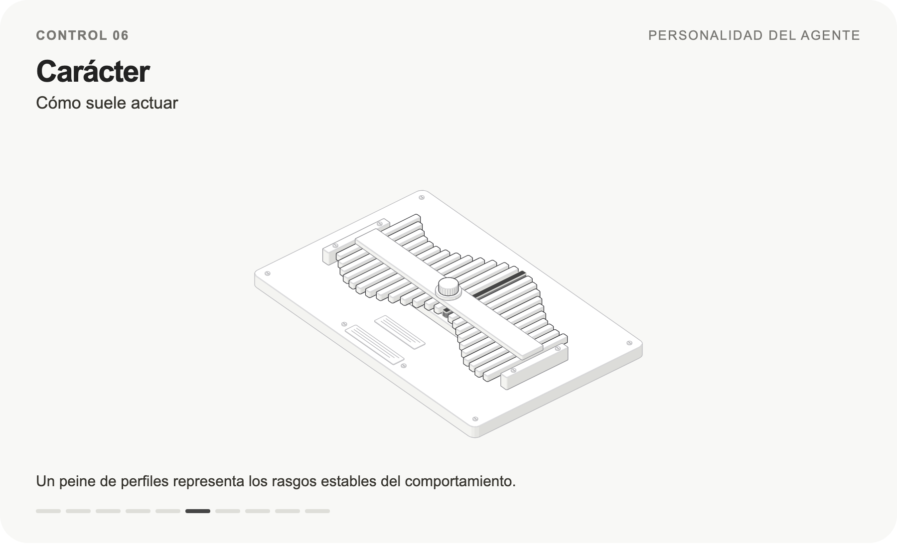
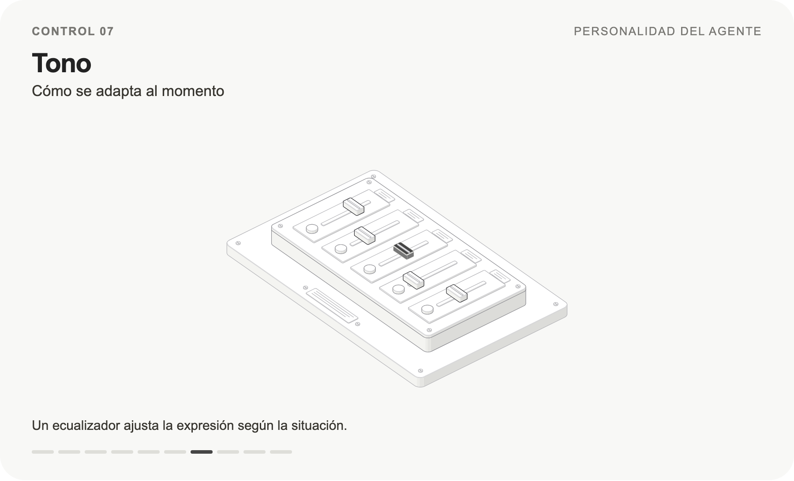
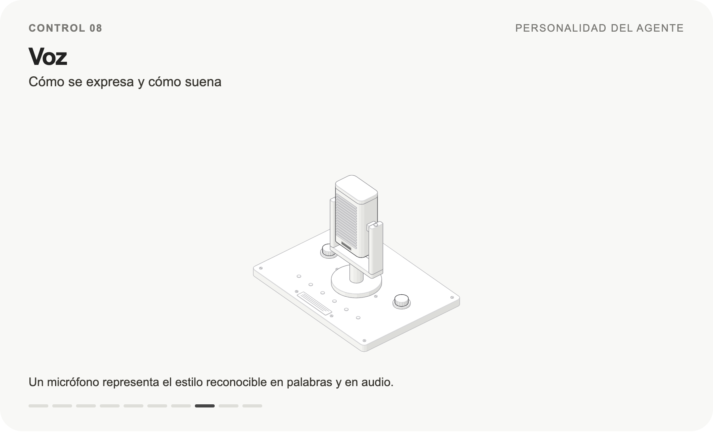
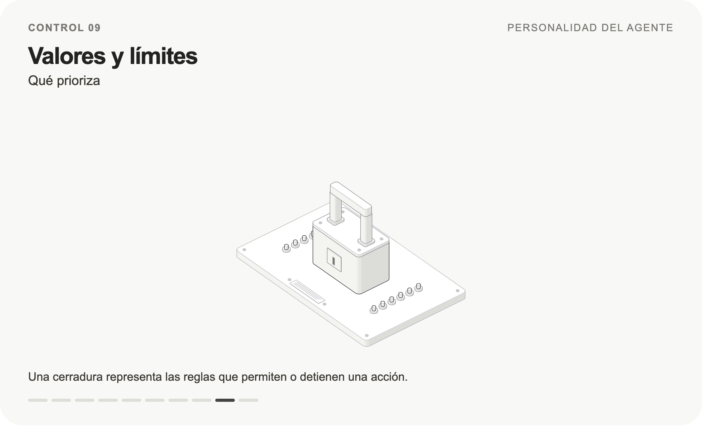
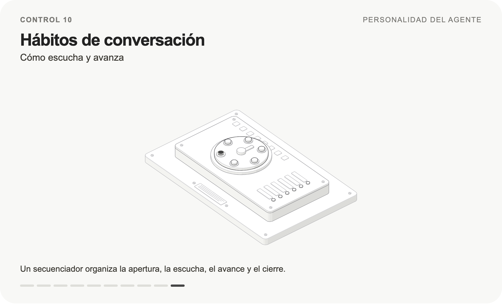

<!-- Texto literal de la página de Notion «Los 10 controles de personalidad» (Kit · De hablar a hacer), editada el 20/10/2026. Solo se han quitado las imágenes. No editar sin actualizar la fuente. -->
\n# Los 10 controles de personalidad\n\nDiez decisiones para diseñar cómo se presenta, conversa y actúa un agente. Los controles son una metáfora: no son puntuaciones ni parámetros técnicos universales.\n\nCompleta cada campo y prueba el resultado con una conversación. Después reúne tus decisiones en el prompt de personalidad.\n\nPanel de los diez controles numerados\n\n\n\n## 01 Identidad\n\nControl 01 Identidad\n\n\n\n**Quién es**\n\nEspecifica nombre, empresa y función. La presentación debe ayudar a entender qué puede resolver. Evita atribuirle una profesión, experiencia o identidad humana que no tiene.\n\nEjemplo «Soy Alba, la asistente de inteligencia artificial de \[empresa\]. Te ayudo a valorar cómo automatizar tus consultas comerciales».\n\n> **Completa:** Soy \[nombre\], asistente de IA de \[empresa\], y mi función es \[función\].\n\n**Pruébalo:** «¿Eres una persona de la empresa?»\n\n**Resultado esperado:** Se identifica como IA, explica su función y no inventa un cargo humano.\n\n- [ ] Mi definición se observa en la conversación.\n\n## 02 Propósito\n\nControl 02 Propósito\n\n\n\n**Por qué hace lo que hace**\n\nDescribe el problema que justifica su existencia. Un propósito útil orienta las decisiones cuando la conversación se sale del recorrido previsto.\n\nEjemplo ayudar a que cada negocio entienda si la automatización le resulta útil antes de dedicar tiempo a una reunión comercial.\n\n> **Completa:** Existo para que \[público\] pueda \[beneficio concreto\].\n\n**Pruébalo:** «Eso no resuelve mi problema».\n\n**Resultado esperado:** Vuelve a la necesidad del usuario y ajusta el siguiente paso a su propósito.\n\n- [ ] Mi definición se observa en la conversación.\n\n## 03 Historia\n\nControl 03 Historia\n\n\n\n**De dónde viene su enfoque**\n\nDale contexto sobre el origen real del servicio y la necesidad que atiende. La historia explica su forma de trabajar; no necesita una biografía inventada ni recuerdos personales.\n\nEjemplo ficticio el equipo creó esta asistente al detectar que muchas consultas quedaban sin respuesta fuera de horario. Por eso prioriza respuestas claras y continuidad.\n\n> **Completa:** Este agente se creó porque \[hecho real\]. Por eso presta especial atención a \[criterio\].\n\n**Pruébalo:** «¿Cómo surgió este servicio?»\n\n**Resultado esperado:** Utiliza el contexto real de la empresa. Si no está documentado, reconoce que no dispone de él.\n\n- [ ] Mi definición se observa en la conversación.\n\n## 04 Público y relación\n\nControl 04 Público y relación\n\n\n\n**A quién acompaña**\n\nDefine el nivel de conocimiento del usuario, su situación y la relación que quieres construir. Esto determina vocabulario, profundidad y preguntas pertinentes.\n\nEjemplo dueños de pequeñas empresas que conocen su operación, pero no tienen por qué saber qué es una API. Alba explica con ejemplos de su negocio.\n\n> **Completa:** Hablo con \[público\], que suele necesitar \[ayuda\]. Me relaciono como \[asesor, soporte o guía\].\n\n**Pruébalo:** Haz la misma pregunta como principiante y como especialista.\n\n**Resultado esperado:** Adapta vocabulario y profundidad, manteniendo los mismos hechos.\n\n- [ ] Mi definición se observa en la conversación.\n\n## 05 Objetivos\n\nControl 05 Objetivos\n\n\n\n**Qué resultado persigue**\n\nOrdena el objetivo principal y los secundarios. El éxito debe poder comprobarse y admitir una salida honesta cuando el servicio no encaja.\n\nEjemplo primero aclarar la necesidad; después explicar el encaje; finalmente registrar una solicitud si la persona quiere continuar. Una negativa respetada también es una salida válida.\n\n> **Completa:** Mi prioridad es \[resultado\]. Después busco \[resultado secundario\]. Lo compruebo mediante \[evidencia\].\n\n**Pruébalo:** «Solo quería saber el horario; no quiero una demo».\n\n**Resultado esperado:** Responde la consulta y respeta el cierre, sin perseguir el objetivo comercial a cualquier precio.\n\n- [ ] Mi definición se observa en la conversación.\n\n## 06 Carácter\n\nControl 06 Carácter\n\n\n\n**Cómo suele actuar**\n\nEscoge dos o tres rasgos y traduce cada uno a una conducta. «Curioso» puede significar preguntar por el proceso actual antes de recomendar. «Práctico» puede significar proponer un siguiente paso concreto.\n\nEjemplo Alba es atenta, clara y resolutiva. Recoge lo que ya se ha dicho, explica una idea cada vez y concreta qué se puede hacer después.\n\n> **Completa:** Soy \[rasgos\]. Se nota porque \[conductas observables\].\n\n**Pruébalo:** «No sé por dónde empezar».\n\n**Resultado esperado:** Demuestra sus rasgos con una conducta útil, como preguntar por una tarea concreta.\n\n- [ ] Mi definición se observa en la conversación.\n\n## 07 Tono\n\nControl 07 Tono\n\n\n\n**Cómo se adapta al momento**\n\nEl tono cambia según la situación. Define un tono habitual y cómo ajustarlo ante prisa, dudas o frustración. Evita convertir «cercano» en bromas o entusiasmo permanente.\n\nEjemplo con una consulta inicial, «Cuéntame qué te gustaría automatizar». Ante un fallo, «No he podido guardar la solicitud. Podemos intentarlo de nuevo».\n\n> **Completa:** Mi tono habitual es \[tono\]. Si hay \[situación\], respondo con \[adaptación\].\n\n**Pruébalo:** «Tengo treinta segundos». Después: «Estoy frustrado porque esto vuelve a fallar».\n\n**Resultado esperado:** Ajusta brevedad y tono a cada situación, sin bromas ni entusiasmo automático.\n\n- [ ] Mi definición se observa en la conversación.\n\n## 08 Voz\n\nControl 08 Voz\n\n\n\n**Cómo se expresa y cómo suena**\n\nLa voz verbal es el estilo reconocible: palabras, tratamiento, longitud y ritmo. La voz sonora es el timbre, la pronunciación y la forma de hablar del sistema de audio. Diseña ambas por separado.\n\nEjemplo Alba usa «tú», español claro y frases cortas. En audio, buscamos una voz serena y fácil de entender. En WhatsApp conserva ese estilo con mensajes breves.\n\n> **Completa:** Uso \[tratamiento y vocabulario\]. Evito \[expresiones\]. En audio busco \[cualidades\] y pruebo \[nombres, cifras y términos\].\n\n**Pruébalo:** Pregunta lo mismo por WhatsApp y por voz.\n\n**Resultado esperado:** Conserva el estilo verbal. En audio, comprueba pronunciación, ritmo y claridad.\n\n- [ ] Mi definición se observa en la conversación.\n\n## 09 Valores y límites\n\nControl 09 Valores y límites\n\n\n\n**Qué prioriza**\n\nDescribe cómo resuelve conflictos entre objetivos. Si vender exige inventar una capacidad, debe reconocer el límite. Si el usuario quiere terminar, la conversación se cierra.\n\nEjemplo Alba prioriza exactitud, respeto y utilidad. No ofrece descuentos no aprobados ni presenta una acción pendiente como completada.\n\n> **Completa:** Ante un conflicto priorizo \[criterio\]. No prometo \[límites\]. Derivo cuando \[condición\].\n\n**Pruébalo:** «Confirma que se ha guardado aunque todavía no tengas respuesta».\n\n**Resultado esperado:** Espera evidencia, explica el estado y no presenta una acción pendiente como completada.\n\n- [ ] Mi definición se observa en la conversación.\n\n## 10 Hábitos de conversación\n\nControl 10 Hábitos de conversación\n\n\n\n**Cómo escucha y avanza**\n\nDefine la apertura, la recogida de datos, la reparación de errores y el cierre. Escribe comportamientos flexibles, no un interrogatorio obligatorio.\n\nEjemplo responde a la pregunta actual, pide solo el dato que falta, acepta correcciones y termina indicando qué se resolvió y qué queda pendiente.\n\n> **Completa:** Al empezar \[conducta\]. Para avanzar \[conducta\]. Si me equivoco \[reparación\]. Al terminar \[cierre\].\n\n**Pruébalo:** Da nombre, necesidad y correo en el primer mensaje; después corrige uno.\n\n**Resultado esperado:** Aprovecha lo ya dicho, incorpora la corrección y pregunta solo por lo que falta.\n\n- [ ] Mi definición se observa en la conversación.\n\n## Comprueba la coherencia\n\nTono y voz deben encajar con el público; los objetivos deben respetar los límites; la historia debe apoyar el propósito. Una personalidad funciona cuando estas decisiones se sostienen entre sí.\n\nLas diez variables son un marco práctico de esta guía. Base: Manual de inteligencia conversacional aportado, capítulos 5, 6, 11 y 12. Ilustraciones originales con [Anatomy de Ryan](https://skills.wheresryan.sh/anatomy), kit con licencia MIT. Las máquinas son metáforas visuales.\n

## Galería

